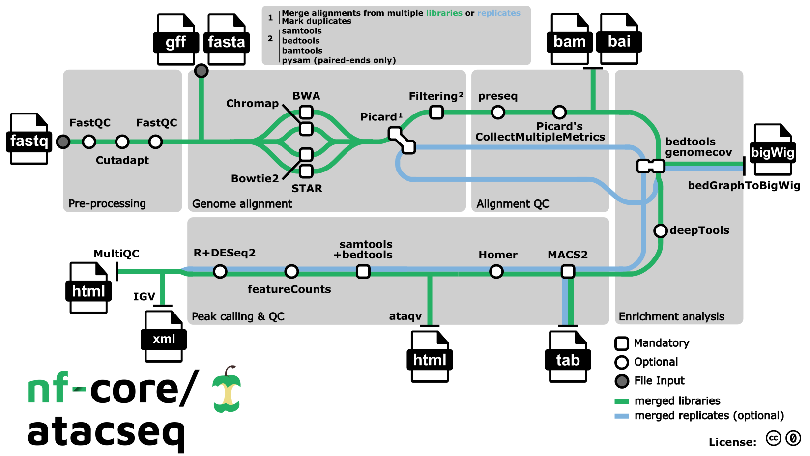

# nf-core/atacseq：用一把“分子剪刀”，找出基因组的开放区域

人体大多数有核体细胞拥有基本相同的DNA，却各有分工。一个直观的理解是：细胞不仅要有“说明书”，还要决定哪些页方便翻开，哪些页暂时收起来。

ATAC-seq 研究的，就是染色质的这种“可访问程度”。
而 nf-core/atacseq，则把测序后的数据整理成可以检查、比较和继续分析的结果。

## 1. 2013 年：把建库工具变成染色质探针

ATAC-seq 并不是第一个研究开放染色质的方法。在它出现之前，研究者已经使用 DNase-seq 等技术寻找这些区域。2013 年，Buenrostro 等人在 *Nature Methods* 发表 ATAC-seq，把一种更简便的实验思路带到了这个领域。[2]

它的巧思在于 **Tn5 转座酶**。这种酶能够切割 DNA，并把测序接头接到 DNA 上。在染色质中，DNA 的包装程度不同，Tn5 接近它的难易程度也不同：相对开放的区域更容易被插入接头。测序后，再把这些片段定位回基因组，就能推断哪些区域更容易被访问。[2]当然，标签多少也会受到实验条件和酶的偏好影响，因此测出来的是需要质控和统计解释的信号。

不同于 ChIP-seq 针对特定蛋白质与 DNA 的结合位置进行检测，ATAC-seq 和 DNase-seq主要用于描绘全基因组的染色质开放区域，无需针对特定蛋白质的抗体。相较于 DNase-seq，ATAC-seq利用Tn5转座酶同时完成 DNA 切割和测序接头插入，通常所需细胞更少、建库步骤更简洁，因此更适合样本量有限的研究。

## 2. 有趣的是，片段长度也在“讲故事”

ATAC-seq 的信息不只来自“片段落在哪里”。DNA 会缠绕在组蛋白上形成核小体。测序得到的片段长度，因此也能反映这种包装结构：较短片段常与核小体缺失区域有关，较长片段可以包含一个或多个核小体对应的结构信息。[2]

所以，片段长度分布并不是报告里凑数的一张图。它把实验信号与染色质结构联系起来。这项技术后来继续改进。2017 年，Corces 等人提出 **Omni-ATAC**，改善信噪比，并拓展了对冷冻组织等样本的适用性。ATAC-seq 的发展，也是一段不断降低样本和实验门槛的历史。[3]

## 3. 这条流程，最初竟然还与牛有关

官方致谢记录：流程最初由 **Harshil Patel** 编写，后来由 **Björn Langer** 和 **Jose Espinosa-Carrasco** 在 **BovReg 项目**框架下迁移到 Nextflow DSL2。[1]

BovReg 研究牛基因组的功能调控，希望理解基因组及表观遗传差异如何与不同牛品种的性状联系起来。[4]

牛为什么也需要 ATAC-seq？因为知道 DNA序列，只是理解性状的一部分。要研究基因调控，还需要知道哪些区域在特定细胞或条件下可以被访问。这正是染色质可及性研究能够提供的线索。

## 4. Workflow：从 FASTQ 到开放染色质图谱

本文介绍的是 **2.1.2 版本**。下图来自官网：绿色线路表示文库合并后的分析，蓝色线路表示可选的跨生物学重复合并分析；方形节点表示必需步骤，圆形节点表示可选步骤。[1]

*图 1. nf-core/atacseq 流程概览（2.1.2 版本）。来源：nf-core/atacseq。[1]*

### 4.1 先清理 reads，再定位到基因组

原始 FASTQ 先经 **FastQC** 检查质量，再由 **Trim Galore!** 调用 Cutadapt 去除接头并进行质量修剪，随后再次质控。比对工具可选择 **BWA（默认）、Bowtie2、STAR 或 Chromap**。需要注意，2.1.2 中 Chromap 的双端数据仅处理到比对阶段，不进入后续分析。[1,5]

比对后，**Picard** 标记重复并合并同一生物学重复内的多批测序数据，再次标记重复后进行过滤。**SAMtools、BEDTools、BAMTools 和 Pysam** 共同去除线粒体来源、黑名单区域、重复及不可靠比对，并检查双端 reads 的配对情况。这一步减少技术噪声对峰识别的干扰。[1]

### 4.2 过滤之后，几条分析线路并行展开

| 分析任务 | 主要工具 | 作用 |
| --- | --- | --- |
| 比对与文库质控 | Picard、Preseq | 检查比对质量，估计文库复杂度及继续测序的收益 |
| 信号轨道生成 | BEDTools、bedGraphToBigWig | 生成按每百万 mapped reads 缩放的 bigWig |
| 信号富集检查 | deepTools | 查看转录起始位点、基因体及全基因组的信号分布 |
| 峰识别与注释 | MACS2、HOMER | 找到信号富集区域，注释其基因组位置及附近基因 |
| 共同区域构建与计数 | BEDTools、featureCounts | 整合 consensus peaks，在相同区域统计各样本 reads |
| 样本比较与报告 | R/DESeq2、ataqv、MultiQC、IGV | 进行标准化、PCA 和聚类，汇总质控并支持轨道浏览 |

以上步骤对应官网流程图中的比对质控、富集分析、峰识别及报告分支。[1,5]

### 4.3 读图时，三个细节容易被忽略

**第一，合并文库与合并生物学重复是两件事。** 同一个重复分多次测序时，样本表中的 `sample` 和 `replicate` 相同，数据会在比对后合并。同一实验组的不同生物学重复，则使用相同 `sample`、不同 `replicate`。蓝色线路进一步合并这些重复以提高峰识别的覆盖度；即使使用这条线路生成的共识峰，计数仍来自各重复分别保留的比对数据，避免丢失重复之间的差异。[5]（样本表填写规则见[官方使用文档](https://nf-co.re/atacseq/2.1.2/docs/usage/)。）

**第二，峰的形状与共识峰的筛选都有默认设置。** 该版本的 MACS2 默认调用 broad peaks，可用 `--narrow_peak` 改为 narrow peaks。Consensus peaks 默认来自各样本峰的并集，并不要求每个样本都出现；可通过 `--min_reps_consensus` 提高重复支持要求。[5]

第三，流程里的DESeq2会生成PCA和聚类图，帮助查看样本是否相似；要判断处理组与对照组哪些区域有显著差异，还需要按实验分组设置统计分析。[5]

## 5. nf-core/atacseq 把数据变成了什么？

实验负责留下“标签”，分析流程负责解释标签的位置和分布。

2.1.2 版本将原始测序质控、接头去除、比对、过滤、峰识别和报告生成组织成 Nextflow 工作流，并使用容器管理软件环境。[1]

其中，**peak（峰）**可以理解为测序信号显著富集的一段基因组区域。

阅读结果时，可以先抓住三个问题：[5]

| 想知道什么 | 对应结果 |
| --- | --- |
| 数据是否值得继续分析？ | MultiQC、ataqv 及相关质控指标 |
| 哪些区域存在可及性信号？ | MACS2 peaks、bigWig 信号轨道 |
| 不同样本能否在同一套区域上比较？ | consensus peaks、区域计数矩阵、PCA 和聚类 |

这里的 consensus peaks 是把各样本的峰整合成共同的比较区域。[5]

## 6. 看到了开放区域，然后呢？

ATAC-seq 的吸引力在于它给基因组增加了一个新的观察角度：除了序列本身，还能观察细胞怎样开放和包装这些序列。

nf-core/atacseq 则把这个观察过程落实为可复用的分析步骤。读懂结果之后，真正有意思的工作才开始：把开放区域、基因表达和实验条件连接起来，形成可以检验的生物学解释。

---

## 参考资料

1. [nf-core/atacseq 2.1.2：官方介绍与开发者致谢](https://nf-co.re/atacseq/2.1.2/)
2. [Buenrostro et al., 2013：ATAC-seq 原始论文](https://pubmed.ncbi.nlm.nih.gov/24097267/)
3. [Corces et al., 2017：Omni-ATAC](https://www.nature.com/articles/nmeth.4396)
4. [BovReg：项目背景](https://bovreg.eu/)
5. [nf-core/atacseq 2.1.2：输出文档](https://nf-co.re/atacseq/2.1.2/docs/output/)

