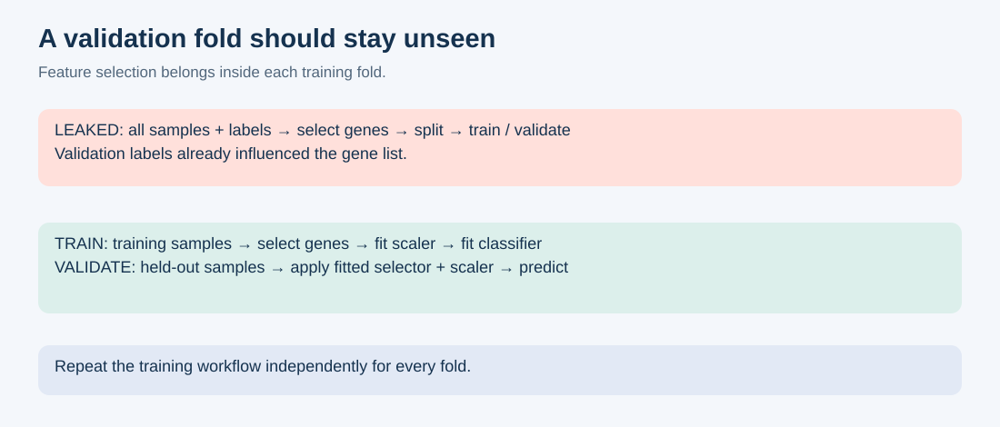
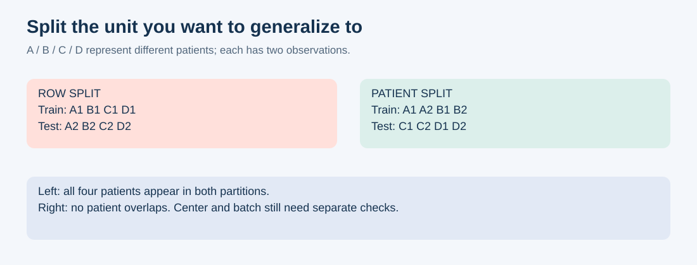
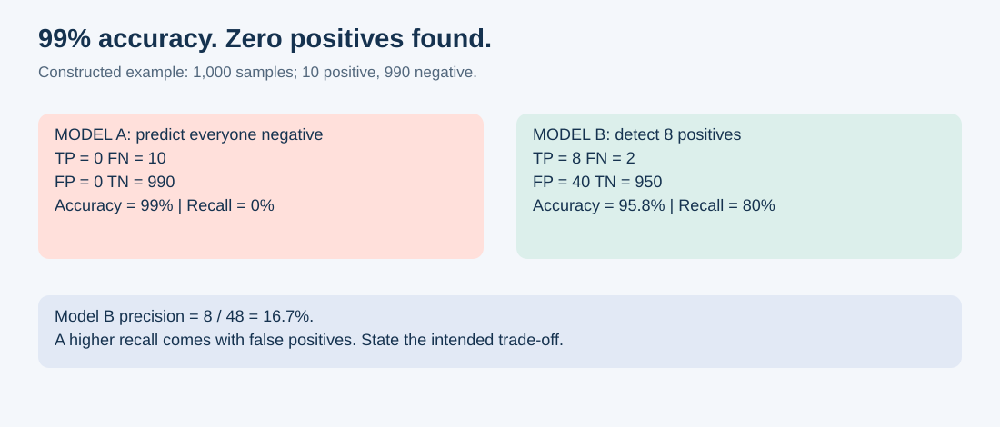

模型的 AUROC 是 0.98。热图很好看，排名靠前的基因也有说得通的生物学功能。

换一个队列，模型却失灵了。

先别急着把逻辑回归换成 Transformer。值得检查的，可能是模型周围的整个实验设计。复杂的算法，也能学会一个非常简单的错误。

本文参考 [Chatomics 的生物信息常见错误文章](https://divingintogeneticsandgenomics.com/post/stupid-mistakes-for-bioinformatics/)中“想做什么—实际做错什么—如何修正”的实用结构。下面的场景是原创教学案例，不是我实际运行过的实验。“愚蠢”指容易预防的流程错误，而不是犯错的人。

## 1. 先筛基因，再做交叉验证

**你原本想做：** 找到一组能预测新患者疾病状态的表达特征。

**你实际做了：** 先用全部患者的疾病标签筛差异基因，再拿这组基因做分类器交叉验证。

验证患者已经参与决定输入特征。只对最后的分类器做交叉验证，无法撤销前面泄露的信息。[Ambroise 与 McLachlan 在 2002 年](https://pubmed.ncbi.nlm.nih.gov/11983868/)就讨论过微阵列分类中的这个问题。

**修正：** 每个训练折内部重新进行有监督基因筛选。如果基因列表来自完全独立的研究，那是另一种情况，但需要记录来源。

```python
# 错误：验证集标签参与了基因筛选。
X_selected = SelectKBest(f_classif, k=100).fit_transform(X, y)
cross_val_score(classifier, X_selected, y, cv=cv, groups=patient_id)

# 改进：每一折只用训练数据拟合特征选择器。
model = make_pipeline(
    SelectKBest(f_classif, k=100),
    StandardScaler(),
    LogisticRegression(max_iter=2000),
)
cross_val_score(model, X, y, cv=cv, groups=patient_id)
```

这是流程片段，完整导入和分组方式见文末。Pipeline 只能保护放在里面的操作，不能修复外部已经泄露信息的基因列表。



*图 1. 原创示意图。上方流程让验证集标签参与选基因；下方流程在每个训练折内学习选择器和标准化参数。图中没有实测性能值。*

## 2. 应该拆患者，却拆了数据行

**你原本想做：** 预测一个从未见过的患者。

**你实际做了：** 随机拆细胞、病理切片小块或重复随访。同一个患者的观测同时出现在训练集和测试集。

模型可能利用患者特有的表达、染色或采集特征。这个分数回答的其实是另一个问题：能否预测部分已经熟悉的患者的其他观测？

**修正：** 按任务对应的独立单位分组。预测新患者就按患者分组；部署到新中心还要考虑留出中心。蛋白质预测则需要检查跨集合的同源序列是否削弱了你想证明的泛化能力。

[scikit-learn 的交叉验证文档](https://scikit-learn.org/stable/modules/cross_validation.html)介绍了分组和时间顺序拆分。按类别分层，不等于按患者隔离。



*图 2. 原创示意图，字母 A–D 代表患者。同一患者的观测保持在同一侧，可以避免直接的患者重叠，但不能保证没有中心或批次混杂。*

## 3. 用整个队列“学习”预处理

**你原本想做：** 让特征在训练前具有可比性。

**你实际做了：** 在全队列上拟合缺失值填补、标准化、PCA 或数据驱动的批次调整，再评价留出的样本。

没有使用疾病标签，也不代表没有使用验证集信息。对于预测未见样本的常规任务，学习转换参数应依靠训练数据。[官方常见陷阱文档](https://scikit-learn.org/stable/common_pitfalls.html)明确讨论了这些预处理操作的泄露风险。

**修正：** 在训练折内拟合，向验证样本应用已拟合的转换。需要区分只处理单个样本、不估计其他样本参数的固定变换，例如固定的对数变换。

训练和测试队列联合整合，可以服务于明确的传导式学习任务；但它不能证明模型能处理拟合时尚不存在的未来样本。一个真正的新样本，怎样独立经过保存好的流程？这是值得回答的问题。

## 4. 先 SMOTE，再拆数据

**你原本想做：** 让模型学会识别少数阳性样本。

**你实际做了：** 对完整数据做过采样后再交叉验证。合成样本可能依赖后来进入验证集的观测，评估集也不再保持原来的类别比例。

**修正：** 每折只对训练部分重采样，验证集和测试集保持原样。`imblearn.pipeline.Pipeline` 可以在拟合阶段管理采样器。[imbalanced-learn 的官方示例](https://imbalanced-learn.org/stable/common_pitfalls.html)展示了全数据重采样的问题。

在样本少、维度高的组学数据里，SMOTE 也不是天然正确。在两个患者之间插出来的点，未必对应一个生物学合理的患者。先与类别权重和简单基线比较。

## 5. 调参，直到测试集满意为止

**你原本想做：** 得到诚实的最终性能估计。

**你实际做了：** 试 30 套基因面板、五种算法和多个随机种子；每次都看测试分数，最后报告冠军。

测试集已经成了模型选择工具。[Cawley 与 Talbot（2010）](https://www.jmlr.org/beta/papers/v11/cawley10a.html)解释了为什么模型选择本身也会对有噪声的评价标准过拟合。

**修正：** 用开发数据调参，冻结流程后再评估最终测试队列。样本有限时可采用嵌套交叉验证：内层选模型，外层评估整个选择过程。参见[官方嵌套交叉验证示例](https://scikit-learn.org/stable/auto_examples/model_selection/plot_nested_cross_validation_iris.html)。

挑最好的随机种子也是选择。预先确定种子，或报告事先规划的一组运行的分布。最高分不是可重复性策略。

## 6. 准确率 99%，一个阳性都没找到

**你原本想做：** 检出罕见结局。

**你实际做了：** 只报告 accuracy，没有看混淆矩阵。

1,000 个样本里有 10 个阳性。全部预测阴性，准确率就是 99%，召回率却是 0%。这是算术例子，不是模拟性能实验。



*图 3. 人工构造的例子，不是患者数据。模型 A 全部预测阴性；模型 B 找到 10 个阳性中的 8 个，同时产生 40 个假阳性。B 的准确率更低；这种取舍是否合适，取决于用途。*

**修正：** 说明阳性比例，展示混淆矩阵，选择符合任务的指标。阳性罕见时，precision-recall 汇总指标可能有帮助，但其基线和解读依赖阳性比例。AUROC 衡量排序能力，不等于特定阈值下的表现。[官方指标文档](https://scikit-learn.org/stable/modules/model_evaluation.html)给出了这些量的定义。

再与 [DummyClassifier](https://scikit-learn.org/stable/modules/generated/sklearn.dummy.DummyClassifier.html) 比较。没有基线，很容易把自己说服。

## 7. 把 0.5 当成科学阈值

**你原本想做：** 把风险分数变成可执行的决策。

**你实际做了：** 接受默认阈值，并把 0.9 的输出当成可信的 90% 概率。

排序、校准和决策是不同的性质。排序表现好的模型，概率估计也可能很差。检查可靠性图；[概率校准文档](https://scikit-learn.org/stable/modules/calibration.html)解释了这种区别。Brier score 有用，但它不只反映校准。

**修正：** 根据明确的目标，在开发数据上选阈值，再在留出数据上评价固定阈值。不要用最终测试集优化它。[阈值调整文档](https://scikit-learn.org/1.9/modules/classification_threshold.html)展示了：分数不变，改变阈值仍会改变决策。

校准也需要与模型拟合、最终评估合理分离。队列构成或阳性比例变化后，还需要重新检查。

## 8. 训练了批次识别器，却叫它疾病模型

**你原本想做：** 学到与疾病有关的生物学信号。

**你实际做了：** 病例全部来自实验室 A，对照全部来自实验室 B，再随机拆分混合数据。

训练和测试两侧保留了同样的技术捷径。高分可能反映实验室、处理日期或测定平台。

这不是纯粹的想象。[Zech 等人（2018）](https://journals.plos.org/plosmedicine/article?id=10.1371%2Fjournal.pmed.1002683)发现肺炎影像模型能够利用医院信息，跨医院泛化也不稳定。把这个教训用于组学是类比，不是该影像论文的组学结论。

**修正：** 检查结局与批次的交叉表，比较仅使用元数据的基线，并在相关外部队列评估。如果批次与疾病完全混杂，一个批次校正按钮无法证明哪些信号来自生物学。需要能把两者区分开的研究设计。

同样，预后模型只能使用约定预测时点已经可得的信息。结局发生后的测量，会让不可能的预测看起来很容易。

## 9. 把特征重要性写成生物学机制

**你原本想做：** 理解模型为什么能预测。

**你实际做了：** 把排名第一的基因称为疾病驱动基因。

特征重要性描述模型在某种解释方法下的行为，本身不识别因果机制。共表达基因还会相互替代：只打乱其中一个，预测可能几乎不变。

**修正：** 在留出数据上评估重要性，检查相关特征组，考察跨折和跨队列稳定性。[置换重要性文档](https://scikit-learn.org/stable/modules/permutation_importance.html)及[相关特征示例](https://scikit-learn.org/stable/auto_examples/inspection/plot_permutation_importance_multicollinear.html)解释了为什么有用的特征也可能得到很低的置换重要性。

把重要基因当作后续验证候选，并说明机制结论还需要哪些证据。

## 10. 数组形状正确，患者身份全错

**你原本想做：** 把表达谱与正确的标签匹配。

**你实际做了：** 排序表达矩阵，没同步排序元数据；两边转成 NumPy，开始训练。

维度都对。患者都错。

**修正：** 用明确的标识符连接，拒绝重复 ID，在丢弃标签前断言顺序一致。模型也应保存特征名称和顺序。

```python
# X_df：样本 × 基因；metadata：每个 sample_id 一行。
assert X_df.index.is_unique
assert metadata["sample_id"].is_unique
meta = metadata.set_index("sample_id").loc[X_df.index]
assert X_df.index.equals(meta.index)
assert meta["outcome"].notna().all()
y = meta["outcome"].to_numpy()
```

纵向数据应使用唯一的观测 ID 对齐，再使用单独的患者 ID 分组。不要把多次随访强行套进“每个患者一行”的假设。

## 一个值得留下来的小模板

下面用于**按患者分组的二分类**，不是完整组学流程，也不是性能基准。`X` 应已正确对齐、为数值且无缺失；`y` 是二分类标签，`patient_id` 是患者分组。每折必须有足够的患者和类别覆盖，`k` 应适配实际特征数。

```python
import numpy as np
from sklearn.feature_selection import SelectKBest, f_classif
from sklearn.linear_model import LogisticRegression
from sklearn.model_selection import StratifiedGroupKFold, cross_validate
from sklearn.pipeline import make_pipeline
from sklearn.preprocessing import StandardScaler

cv = StratifiedGroupKFold(n_splits=5, shuffle=True, random_state=42)
for train, valid in cv.split(X, y, groups=patient_id):
    assert not (set(patient_id[train]) & set(patient_id[valid]))
    assert len(np.unique(y[train])) == len(np.unique(y[valid])) == 2

model = make_pipeline(
    SelectKBest(f_classif, k=100),
    StandardScaler(),
    LogisticRegression(max_iter=2000),
)
scores = cross_validate(
    model, X, y, groups=patient_id, cv=cv,
    scoring={"auroc": "roc_auc", "ap": "average_precision"},
)
print(scores["test_auroc"])
print(scores["test_ap"])
```

它评估固定流程。如果根据这些分数选择 `k`、正则化强度或算法，就需要内层选择、外层评估。五个相关的折分数不是五次独立实验，也不能自动解释为置信区间。代码只做了语法检查，没有在生物数据集上运行。

## 下次看到漂亮分数时

先问四件事：**留出了谁？什么信息越过了边界？这个指标支持什么决策？有没有更简单的解释？**

保存拆分 ID、特征结构、预处理对象、环境版本和选择历史。固定种子有助于复现流程，却不能让错误流程变正确。

最昂贵的错误，往往会生成一张漂亮的图，而且不报任何错。

*资料核查日期：2026 年 10 月 12 日。文档随版本变化，真实分析应固定环境版本。三幅图均为原创教学图解。*
