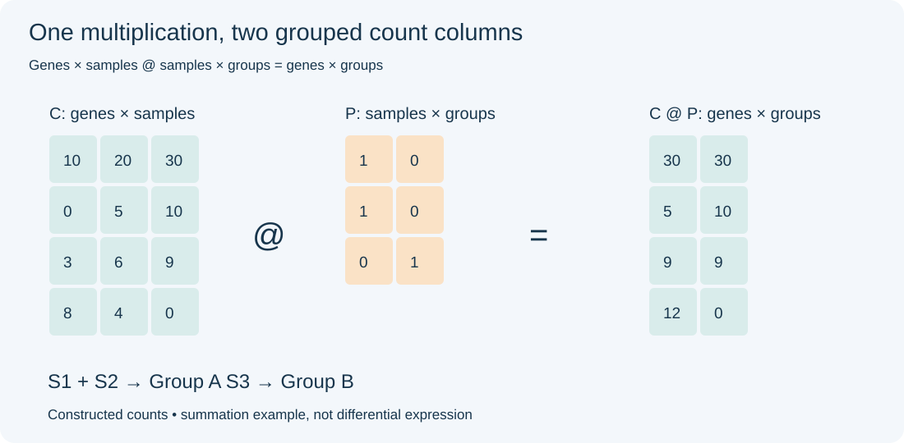
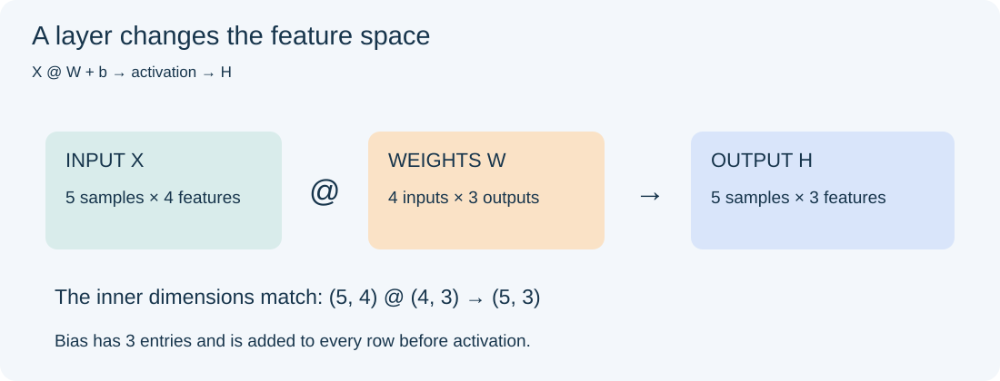
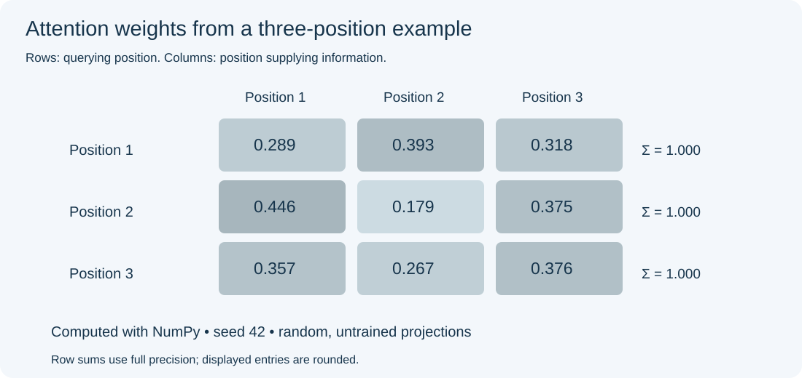

## 1. Tensors have a funny name. Matrices are fashionable, too.

The Chinese word for tensor is **张量**, pronounced *zhāng liàng*. My surname is also Zhang. Every time I look at the word, I wonder whether I should adopt it as my name. That would give me a connection to deep learning before I even wrote any code.

Just a small joke from someone named Zhang.

“Matrix” has its own appeal. A name like “Matrix Technology” sounds ready for an office full of algorithms. “Magic square” adds a mathematical twist: a square arrangement of numbers whose rows, columns, and two main diagonals have equal sums.

But a matrix is more than a fashionable name. Open an expression table, and you are probably already looking at one.

| Name | A practical picture | Example |
| --- | --- | --- |
| Scalar | One number | Sequencing depth for one sample |
| Vector | A sequence of numbers | One gene's expression across samples |
| Matrix | Numbers arranged in rows and columns | Genes × samples |
| Tensor | An array that can have more axes | Batch × sequence positions × features |

Deep learning libraries commonly call these arrays tensors. Mathematical tensors have a more precise definition, but array shape is a useful starting point here. The number of axes should not be confused with matrix rank.

## 2. Much of bioinformatics starts with a matrix

Different experiments often give us similarly structured tables:

| Data | Common rows × columns | Meaning of an entry |
| --- | --- | --- |
| Bulk RNA-seq | Genes × samples | Assigned read or fragment counts, sometimes estimated counts |
| Single-cell RNA-seq | Genes × cells | Deduplicated UMI counts in common droplet-based UMI assays |
| ChIP-seq | Peaks × samples | Reads or fragments counted within a peak |
| Drug response | Drugs × samples | IC50 or another sensitivity measure |

A single-cell count need not be a raw read count. For example, [Cell Ranger gene-expression matrices](https://www.10xgenomics.com/support/software/cell-ranger/latest/analysis/outputs/cr-outputs-mex-matrices) record UMI counts: several reads can correspond to one counted molecule.

Orientation varies, too. Some tools store cells × genes. Before calculating anything, ask: **What does a row represent? What does a column represent? What does an entry measure?**

For IC50, check units, missingness, and measurement limits. Under comparable assay conditions, a lower value generally means a lower concentration is needed for half-maximal inhibition. Values from different conditions should not be pooled uncritically.



*Figure 1. Four synthetic genes and three samples. Matrix multiplication combines S1 and S2 into group A and assigns S3 to group B.*

### 2.1 Transpose: turn the table around

Let `C` have four gene rows and three sample columns:

```python
import numpy as np

C = np.array([
    [10, 20, 30],
    [ 0,  5, 10],
    [ 3,  6,  9],
    [ 8,  4,  0],
])
print(C.shape)    # (4, 3): genes × samples
print(C.T.shape)  # (3, 4): samples × genes
```

Transposition swaps the axes without changing the values. It is useful when a machine learning tool expects samples in rows and features in columns.

### 2.2 Matrix multiplication: match, multiply, and add

For `A` with shape `m × k` and `B` with shape `k × n`:

$$
(AB)_{ij}=\sum_{r=1}^{k}A_{ir}B_{rj},\qquad AB\text{ has shape }m\times n.
$$

Start with one output entry: take a row from the left matrix and a column from the right, multiply matching entries, then add them.

To sum S1 and S2 into group A while leaving S3 in group B:

```python
P = np.array([
    [1, 0],  # S1 → A
    [1, 0],  # S2 → A
    [0, 1],  # S3 → B
])
group_counts = C @ P
print(group_counts)
# [[30 30]
#  [ 5 10]
#  [ 9  9]
#  [12  0]]
```

The shapes are `(4, 3) @ (3, 2) → (4, 2)`. The three-sample axis is summed over, leaving four genes and two groups.

This demonstrates summation, not differential expression. Do not casually pool biological replicates: sequencing depth and the number of samples affect group totals. Single-cell pseudobulk commonly aggregates separately by biological sample and cell type to preserve replication.

### 2.3 `*` and `@` are different operations

In NumPy, `*` multiplies entries element by element, while `@` performs matrix multiplication. The [official documentation](https://numpy.org/doc/stable/reference/generated/numpy.matmul.html) describes its shape rules.

```python
A = np.array([[1, 2], [3, 4]])
B = np.array([[5, 6], [7, 8]])
print(A * B)  # [[ 5, 12], [21, 32]]
print(A @ B)  # [[19, 22], [43, 50]]
```

Both lines run. They answer different questions. That little symbol deserves a second look when reading code.

### 2.4 PCA: look along a different set of directions

Matrices can describe directions in which to examine data. PCA finds directions of large variation and projects samples onto them.

Here is a small example using singular value decomposition (SVD):

```python
E = np.log1p(C.T.astype(float))       # samples × genes
E_centered = E - E.mean(axis=0, keepdims=True)
U, s, Vt = np.linalg.svd(E_centered, full_matrices=False)
scores = E_centered @ Vt[:2].T
print(scores.shape)                 # (3, 2)
```

`Vt[:2].T` supplies two directions; `scores` contains the coordinates of three samples along them. The [NumPy SVD documentation](https://numpy.org/doc/stable/reference/generated/numpy.linalg.svd.html) explains the factorization and reconstruction.

Direct `log1p` is only a teaching shortcut here. Real RNA-seq PCA requires appropriate depth handling and transformation, plus a decision about gene scaling. Large variation may reflect disease, batch, or something else; PCA does not decide that for us.

## 3. Deep learning also runs on matrix operations

A fully connected layer can be written as:

$$H=f(XW+b).$$

`X` holds inputs, `W` holds learned weights, `b` is a bias, and `f` is an activation function. Each output feature starts as a weighted sum of input features.



*Figure 2. Five samples with four features pass through a `4 × 3` weight matrix, producing three output features per sample. Bias is added to each row.*

```python
X = np.ones((5, 4))
W = np.ones((4, 3))
b = np.zeros(3)
H = np.maximum(0, X @ W + b)  # ReLU
print(H.shape)               # (5, 3)
```

Without nonlinear activation, several layers of multiplication and bias can still be combined into one affine transformation. More layers alone do not automatically yield a richer function.

For a batch of sequences, the input might be batch × tokens × features. The array now has three axes, but multiplication still often operates on the last two. Calling it a tensor does not make familiar arithmetic disappear.

## 4. Two multiplications inside Transformer attention

Attention can be approached through two questions:

1. How much information should each position take from the others?
2. How should that information be combined?

The [original Transformer paper](https://arxiv.org/abs/1706.03762) defines scaled dot-product attention as:

$$\operatorname{Attention}(Q,K,V)=\operatorname{softmax}\left(\frac{QK^T}{\sqrt{d_k}}\right)V.$$

Different weight matrices map the input to `Q`, `K`, and `V`. `Q @ K.T` produces scores between positions. Row-wise softmax turns them into weights summing to one. Those weights then combine the rows of `V`.

Here is one unmasked attention head with random, untrained weights:

```python
rng = np.random.default_rng(42)
X = rng.normal(size=(3, 4))    # three positions, four features each
Wq = rng.normal(size=(4, 2))
Wk = rng.normal(size=(4, 2))
Wv = rng.normal(size=(4, 2))
Q, K, V = X @ Wq, X @ Wk, X @ Wv

scores_attention = Q @ K.T / np.sqrt(Q.shape[1])
z = scores_attention - scores_attention.max(axis=-1, keepdims=True)
A = np.exp(z)
A /= A.sum(axis=-1, keepdims=True)
Y = A @ V
print(A.shape, Y.shape)       # (3, 3) (3, 2)
```

Subtracting each row's maximum improves numerical stability without changing softmax. A row of `A` describes how one position distributes its weights; `Y` contains the combined representations.



*Figure 3. Computed attention weights from the fixed-seed example above; every row sums to one. These are random weights, not results from a trained language model.*

A complete Transformer also uses multiple heads, position information, residual connections, normalization, and feed-forward networks. Text generation usually requires a causal mask so a position cannot read future positions. The example shows only one core operation.

From grouped expression sums to PCA projection and attention, matrix multiplication keeps turning one collection of numbers into another. The important questions remain: what do the axes mean, where did the weights come from, and what does the output help us understand?

The full [matrix_demo.py](examples/matrix_demo.py) requires NumPy:

```bash
python3 examples/matrix_demo.py
```

*Examples were run with NumPy 2.3.5. Checks cover grouped sums, SVD reconstruction, and attention row sums. All data are constructed for teaching, not real sequencing observations.*
