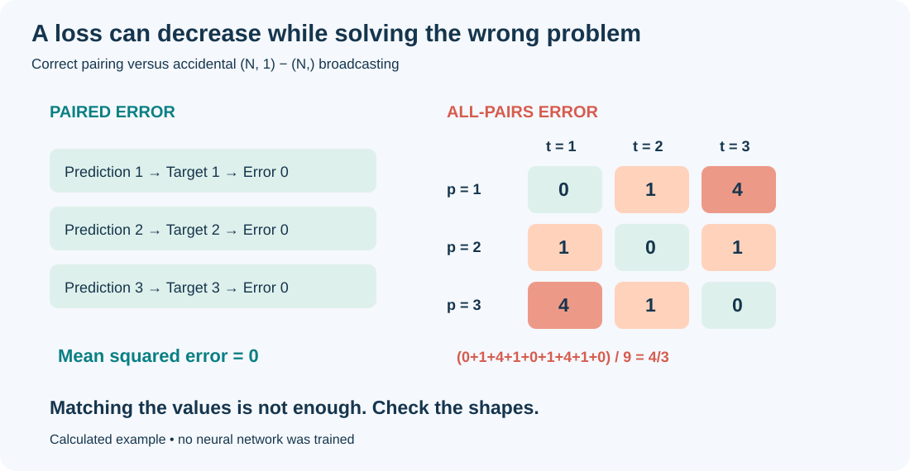
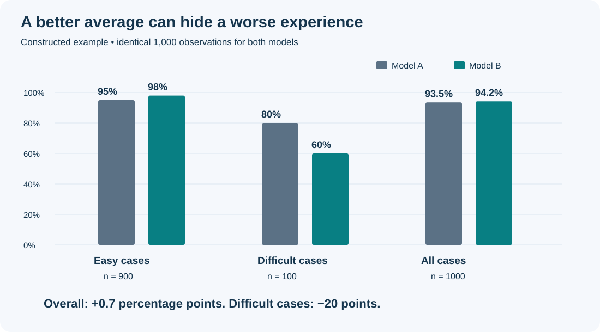
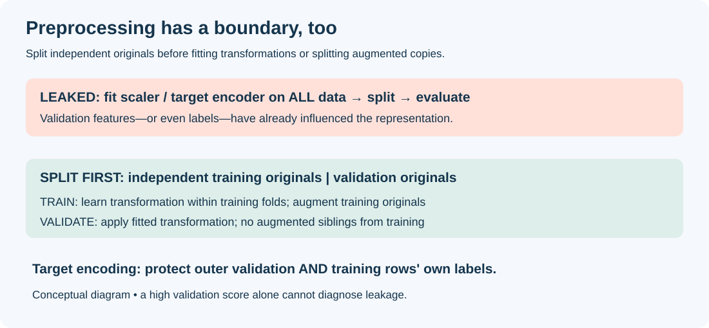
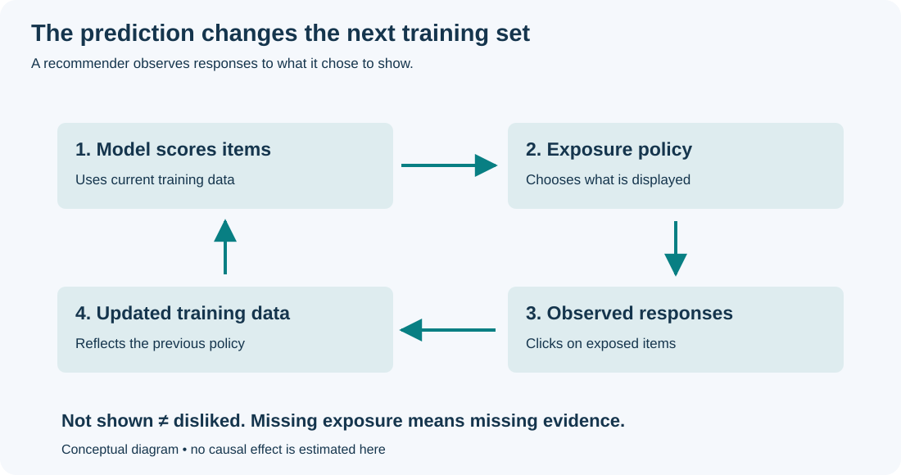

程序跑起来了。损失在下降。输出目录里也有了 checkpoint。

这三件事，都不能证明实验有意义。

有些机器学习错误会抛异常。更昂贵的错误，会生成一张很有说服力的图。你可能花一周调模型，让它更擅长解决一个错误的问题；再花一周解释为什么它表现这么好。

这篇文章整理十个具体陷阱，参考学者的经验文章、原始论文和框架文档。下面的场景与图解均为原创，不能视为那些作者实际运行过的实验。“愚蠢”指可以预防的错误，而不是犯错的人。

## 1. 没看清数据，就先选模型

**你原本想做：** 解决一个预测问题。

**你实际做了：** 还没弄清数据和标签从哪里来，就选好了热门网络。

文件夹叫 `clean_data`，不代表数据干净。缺失值被编码成 `-999`，可能变成强特征。两个标注者可能对“阳性”有不同定义。时间戳可能记录上传时间，而不是你想预测的事件时间。

Sambasivan 等人的 [Data Cascades 研究](https://research.google/pubs/everyone-wants-to-do-the-model-work-not-the-data-work-data-cascades-in-high-stakes-ai/)讨论了忽视数据工作怎样造成层层累积的问题。它来自实践者访谈，不是适用于所有项目的统计定律。

**修正：** 按标签、来源和时间段查看真实样本。阅读标注规则，画缺失值分布，检查重复数据。写清楚“一行代表什么”和“标签到底测量什么”。

看到 `-999`，先确认它是缺失值占位符还是合法取值，再决定如何处理。未经检查就把占位符当作数值喂给 Transformer，模型可能认真学习你根本不想让它学习的编码规则。

### 数据正确，还要在预测时可得

同一份数据还要回答另一个问题：**预测发生的那一刻，这个特征真的已经可得了吗？** 随机拆有时间依赖的观测，或使用预测时点之后才拿到的记录，都可能让评估偏离真实预测任务。

“未来七天购买次数”在特征表里可能有个普通名字，但今天做预测时仍然不可得。一条记录的发生时间，也未必是系统拿到它的时间。

**修正：** 写清楚什么时候做预测，以及那一刻能拿到哪些数据。计算特征时只用当时已经可得的记录，再用较晚的数据评估。有重叠的预测窗口时，也要检查两边是否共享了不该共享的信息。光按时间拆分，不能去掉特征里已经混入的未来数据。

[Martin Zinkevich 的机器学习规则](https://developers.google.com/machine-learning/guides/rules-of-ml)建议用训练期之后采集的数据评估。具体划分仍需符合应用与依赖结构。

## 2. 打败一个没有认真参赛的基线

**你原本想做：** 证明新模型提高了预测能力。

**你实际做了：** 给自己的方法反复调参，却只给基线一个不合适的配置，然后把差距归功于新结构。

Ferrari Dacrema、Cremonesi 和 Jannach 在 [2019 年推荐算法研究](https://arxiv.org/abs/1907.06902)中发现，认真调参的简单方法可以超过他们复现的多种神经方法。这是关于所研究方法与基准的证据，不能外推成“神经网络永远没用”。

**修正：** 给基线合理的调参资源、相同的信息和评估协议。加入符合任务的简单规则，例如时间序列预测中的“下一个值等于最近一个值”。同时报告计算开销和延迟。

不能只让竞争对手背着“默认参数”的包袱比赛。

## 3. 连一个小训练批次都没拟合，就开始扩规模

**你原本想做：** 训练一个有用的神经网络。

**你实际做了：** 还没验证几个样本能不能学会，就启动大规模训练。

Karpathy 的[神经网络训练经验文章](https://karpathy.github.io/2019/04/25/recipe/)建议查看实际输入张量，并把刻意拟合一个小批次作为调试步骤。

**修正：** 关闭数据增强，简化模型，用固定的少量、标签清楚的样本训练。在容量足够、标签不矛盾时，应当能拟合这些样本。如果失败，先检查标签、损失、梯度和优化，而不是先加 GPU。

小批次拟合失败时，打印这几个样本的原始记录、预处理后特征和标签，检查是否有相同输入却有不同标签。例如，同一个输入出现两次，一次标正、一次标负；模型对相同输入给出相同预测时，不加权二元交叉熵的最优共同预测是 0.5，平均损失为 `log(2)`，无法归零。多标签任务或带额外上下文的输入，需要另行分析。

同时检查正则化、模型容量、学习率和梯度。不能仅凭拟合失败，就断定原因是重复脏数据。成功记忆小批次仍然只是一项调试检查，不证明泛化能力。

## 4. 让 broadcasting 偷换了优化目标

**你原本想做：** 把每个预测与它对应的目标比较。

**你实际做了：** 用形状 `(N, 1)` 的预测减去形状 `(N,)` 的标签。

根据 [PyTorch 的广播规则](https://docs.pytorch.org/docs/2.9/notes/broadcasting.html)，结果是 `(N, N)` 的矩阵。每个预测都在与每个标签比较。

```python
# 每个样本一个预测，但两边形状不同。
pred = torch.tensor([[1.0], [2.0], [3.0]])  # (3, 1)
target = torch.tensor([1.0, 2.0, 3.0])      # (3,)
wrong = ((pred - target) ** 2).mean()      # 4/3，不是零

assert pred.ndim == 2 and pred.shape[1] == 1
assert target.ndim == 1 and pred.shape[0] == target.shape[0]
pred = pred.squeeze(-1)
assert pred.shape == target.shape
right = ((pred - target) ** 2).mean()      # 零
```

这是 PyTorch 示意片段。配套的[标准库脚本](examples/verify_examples.py)不用 PyTorch 就能复现算术过程，不训练神经网络。



*图 1. 已核算的教学例子。预测与标签都是 `[1, 2, 3]`，正确的逐样本误差为零；广播后的目标却包含九个两两误差，均值为 4/3。*

**修正：** 先确认这里每个样本只有一个输出，再调整形状。即使只有一个样本，`(1, 1).squeeze(-1)` 也会得到 `(1,)`，保留批次维。不要换成无条件 `flatten()`，否则可能把多输出也摊平，藏住另一种错误。其他地方如果还需要二维预测，可以把调整后的结果放在单独变量里。

错误的损失也可以下降。当预测值可以独立调整时，全部两两比较的目标会把每个预测推向标签均值。收敛，不等于目标正确。

## 5. 因为“分类需要概率”，先做一次 softmax

**你原本想做：** 训练多分类模型。

**你实际做了：** 先算 softmax，再把概率送进 `CrossEntropyLoss`。

这里必须区分 `CrossEntropyLoss(input, target)` 的两个参数。[PyTorch 文档](https://docs.pytorch.org/docs/2.9/generated/torch.nn.CrossEntropyLoss.html)规定：

| 参数 | 应传入什么 |
| --- | --- |
| `input`：模型预测端 | 原始 logits；不要先对模型输出做 softmax |
| `target`：监督目标端 | 整数类别索引，或与预测同形状的合法概率分布（软标签） |

软标签支持属于 `target`，不会改变预测端的接口约定。如果把 `softmax(logits)` 传给 `input`，内部会把这些数再次当作 logits 做 log-softmax，计算出不同的损失。代码可能仍然运行，但不再是原本打算优化的交叉熵。

```python
# 每个样本对应一个整数类别标签。
logits = model(x)                       # (batch, classes)
loss = criterion(logits, y)             # criterion = CrossEntropyLoss()
probabilities = logits.softmax(dim=-1)  # 用于查看预测
```

**修正：** 分别检查预测端和目标端的形状、数据类型与取值。整数类别目标通常使用 `long`；软标签使用浮点数，并应满足非负、各类别概率和为一等约束。文档提醒：框架不会替你完整验证概率目标是否合法。用于展示预测的 softmax 可以放在损失计算之外。

对于 `C` 类均匀预测，普通、不加权的交叉熵是 `log(C)`：二分类约 0.693，十分类约 2.303。这个结果也适用于合法软标签，包括均匀软标签：因为目标概率之和为一，`-sum(q * log(1/C)) = log(C)`。这里假设没有类别加权，并按每个样本的损失取平均。

## 6. 把关闭梯度当成进入评估模式

**你原本想做：** 测量训练后模型的验证性能。

**你实际做了：** 用 `no_grad()` 包住预测，以为 dropout 和 batch normalization 也切换成评估行为。

两者职责不同。[`model.eval()`](https://docs.pytorch.org/docs/2.9/generated/torch.nn.Module.html)改变相关模块的行为；[自动求导模式](https://docs.pytorch.org/docs/2.9/notes/autograd.html)控制梯度记录，不会自动选择评估模式。

```python
model.eval()
with torch.no_grad():
    logits = model(x_valid)
    validation_loss = criterion(logits, y_valid)
model.train()  # 下一个训练阶段前恢复训练行为
```

**修正：** 明确设置两者。对于默认跟踪运行统计量的 batch normalization，训练模式下验证可能更新这些统计量。有些应用刻意使用随机推断，但应该有明确协议，而不是误设模式。

## 7. 把最幸运的随机种子写成算法表现

**你原本想做：** 比较两种学习方法。

**你实际做了：** 各跑几次，挑最好的一次，其余不报告。

[Bouthillier 等人](https://arxiv.org/abs/2103.03098)研究了基准结果的多种变异来源；[Agarwal 等人](https://arxiv.org/abs/2108.13264)则讨论了少量运行下深度强化学习评价的不确定性。他们的具体建议有实验背景，不能变成机械的“五个种子就够了”。

**修正：** 事先安排重复运行，保留全部结果，区分初始化、采样、数据划分与调参带来的变异。设计允许时做配对比较，不确定性估计应匹配重复单位。

固定种子帮助调试，但不能保证跨环境完全一致。[PyTorch 可重复性文档](https://docs.pytorch.org/docs/2.9/notes/randomness.html)解释了这些限制。

## 8. 让平均分遮住失败

**你原本想做：** 改善模型对目标用户的表现。

**你实际做了：** 只庆祝汇总指标，没有检查重要子群或条件。

下面是人工构造的例子：900 个容易样本，100 个困难样本。

| 评估切片 | 模型 A 正确数 | 模型 B 正确数 |
| --- | ---: | ---: |
| 容易样本，n = 900 | 855（95%） | 882（98%） |
| 困难样本，n = 100 | 80（80%） | 60（60%） |
| 全部样本，n = 1,000 | 935（93.5%） | 942（94.2%） |

总体提高 0.7 个百分点，困难组却下降 20 个百分点。这里出现了**子群表现退化（subgroup performance degradation）**：模型更新后，某个子群的指标降低，而总体指标仍然提高。由于容易组占 90%，它的收益足以抵消困难组的损失。

这是对可观察现象的描述；仅凭这张表，不能判断退步来自训练数据不足、优化偏好还是其他原因，也不能据此诊断“多数群体偏见”。总体提升是真实的，但不是所有群体都受益。



*图 2. 人工构造并核算的计数，不是实测性能。统一纵轴帮助看清困难组的下降。*

**修正：** 预先定义重要切片，报告样本数与不确定性，检查错误案例。不要看完结果才挑有利切片，小群体估计也可能很不稳定。

[D'Amour 等人的欠规定性研究](https://arxiv.org/abs/2011.03395)提供了相关提醒：域内分数相近的模型，部署表现仍可能不同。一个数字无法描述你对模型的全部要求。

## 9. 把预处理当成随手做的小事


**你原本想做：** 整理输入，再评估模型对未见样本的表现。

**你实际做了：** 在划分训练集和验证集之前，拟合全局 `StandardScaler` 或目标编码器；或者先生成增强副本，再随机拆这些副本。

**现象：** 程序运行顺利，验证表现好得异常，甚至可能出现 99% 准确率。但这个数字只是值得检查的信号，不能据此诊断泄露。

全局标准化会使用验证集特征的均值与方差；目标编码还可能用验证集标签计算类别数值；增强副本跨集合，则让模型提前熟悉验证样本的原型。这是不同的信息泄露路径，后果也不同。参见[官方预处理陷阱文档](https://scikit-learn.org/stable/common_pitfalls.html)。

**修正：** 先拆独立的原始样本，在训练数据上学习预处理，再原样应用到验证数据。交叉验证时，每个训练折内重新拟合。同一原始样本的增强副本留在同一集合；训练增强也必须符合任务的标签语义。

```python
from sklearn.model_selection import train_test_split
from sklearn.preprocessing import StandardScaler

# 错误：验证观测参与估计标准化参数。
X_scaled = StandardScaler().fit_transform(X)
X_train, X_valid, y_train, y_valid = train_test_split(
    X_scaled, y, stratify=y, random_state=42,
)

# 适用于独立观测的正确顺序：先拆分，再拟合。
X_train, X_valid, y_train, y_valid = train_test_split(
    X, y, stratify=y, random_state=42,
)
scaler = StandardScaler()
X_train_scaled = scaler.fit_transform(X_train)
X_valid_scaled = scaler.transform(X_valid)
```

这是说明片段，没有运行模型结果。存在分组或时间依赖时，应替换随机拆分协议。交叉验证中，把 scaler 放入 Pipeline，不要在进入各折之前统一拟合。



*图 3. 原创示意图。训练集学习转换，验证集只接受已拟合的转换；增强副本与原样本保持在同一侧。这里没有实测准确率。*

**目标编码还要防止“用自己的答案编码自己”。** 即使只在训练集内计算，某一行自己的标签也可能进入它的类别统计。[scikit-learn 的 TargetEncoder](https://scikit-learn.org/stable/modules/generated/sklearn.preprocessing.TargetEncoder.html)在 `fit_transform` 中使用内部交叉拟合，因此它有意不同于 `fit(...).transform(...)`。[官方示例](https://scikit-learn.org/stable/auto_examples/preprocessing/plot_target_encoder_cross_val.html)展示了这一区别的意义。

```python
from sklearn.preprocessing import TargetEncoder

# X_cat_train / X_cat_valid 只包含类别特征。
encoder = TargetEncoder(target_type="binary", random_state=42)
# 训练集：内部交叉拟合，避免用一行自己的标签编码自己。
X_cat_train_encoded = encoder.fit_transform(X_cat_train, y_train)
# 独立验证集：应用全部训练数据学到的映射，不使用验证标签。
X_cat_valid_encoded = encoder.transform(X_cat_valid)
```

编码器内部做了交叉拟合，仍然需要独立的验证集。如果同一个人有多条记录，或数据有时间先后，编码器内部的拆分也要遵守这些限制。

泄露不会总让准确率达到 99%，影响有多大要看具体数据和模型。怀疑结果虚高时，检查处理顺序，按正确流程重新评估。

### 上线时，也要用同一套处理

训练时没有泄露，还不够。只保存模型权重，却遗漏标准化参数、特征顺序、词表或缺失值规则，上线后仍可能出错。

同一个 `duration`，离线是秒，线上是毫秒。两边都是数字，程序不一定报错。

保存模型时，把预处理和特征说明一起保存。再拿几条固定输入，检查离线和线上是否给出相同预测。[Sculley 等人的技术债论文](https://research.google/pubs/hidden-technical-debt-in-machine-learning-systems/)讨论了这类模型之外的维护问题。

## 10. 以为模型只是观察世界

**你原本想做：** 从历史行为学习，改善未来决策。

**你实际做了：** 忽视预测系统部署后会改变它随后看到的数据。

推荐器展示商品，曝光使点击成为可能，下一轮训练记录这些点击。没被展示的商品没有点击，却不能证明用户不会喜欢。不断重训，可能不断强化原来的曝光策略。



*图 4. 原创概念图。日志观测同时取决于用户反应和系统选择展示的内容。*

[Perdomo 等人的 Performative Prediction](https://arxiv.org/abs/2002.06673)研究的就是预测如何改变后续数据。这篇论文提供了分析思路，但不能直接解决推荐系统里的所有曝光问题。

**修正：** 不只记录点击，还要记录展示了什么、怎样决定展示。想知道换一种推荐方式是否更好，可以在条件允许时做对照实验。仅靠旧策略留下的点击记录，未必能判断新策略的效果。

## 不用 GPU 就能做的三个检查

配套[验证脚本](examples/verify_examples.py)核对了广播平方误差、均匀预测交叉熵参考值和切片表格，只依赖 Python 标准库。在本文目录运行：

```bash
python3 examples/verify_examples.py
```

这些检查验证的是构造例子，不验证模型。前面的代码展示关键步骤，没有在真实模型上运行。

一个实用的调试顺序是：看真实输入与标签，建立公平基线，检查目标和模式，拟合小训练案例，再按真实条件评估完整流程。每个分数旁边，都写清它想回答的问题。

值得警惕的错误，是你还没有检查原因，它就已经给出了你最希望看到的结果。

## 延伸阅读

正文链接的资料承担不同角色：Domingos 和 Karpathy 提供实践视角，Zinkevich 讨论工程经验，基准与部署论文提供特定场景下的证据，PyTorch 文档定义 API 行为。没有哪一篇能成为所有数据集的通用配方。

*资料核查日期：2026 年 10 月 12 日。PyTorch API 链接使用 2.9 版以明确接口约定。全部图解为原创，数值例子均为构造并由附带脚本核对。*
